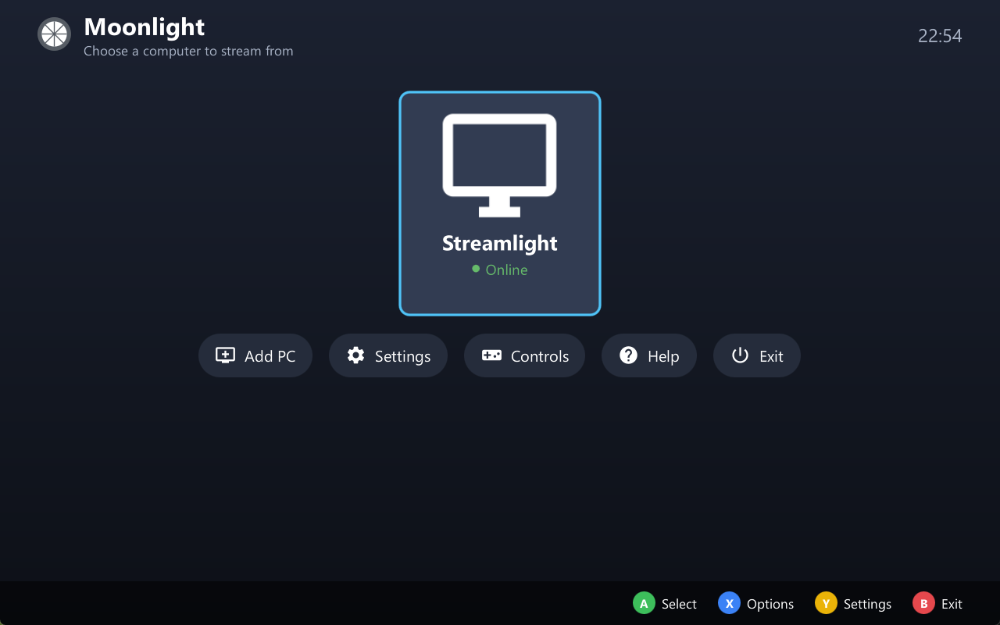
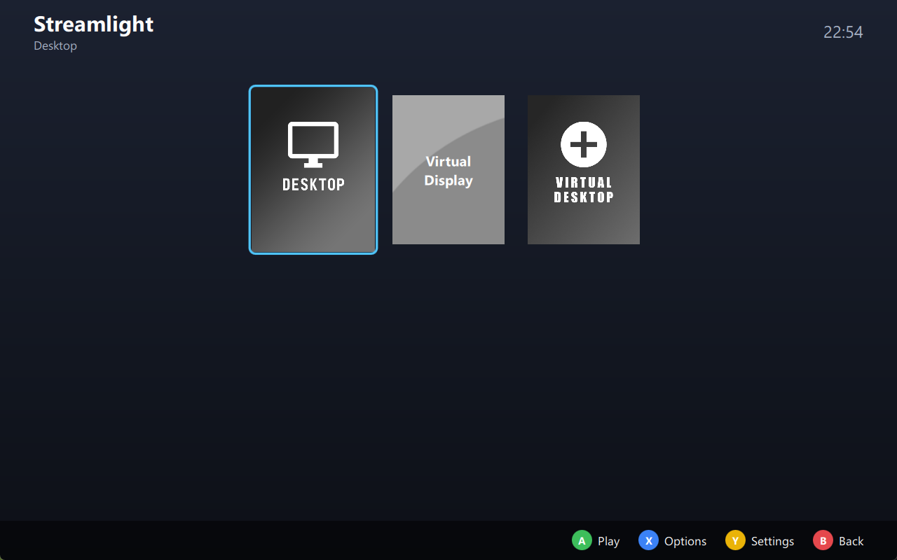
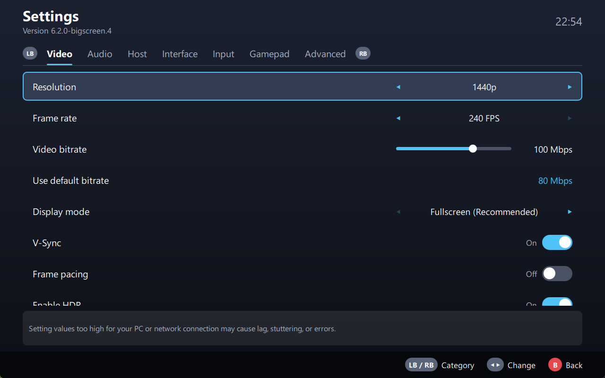
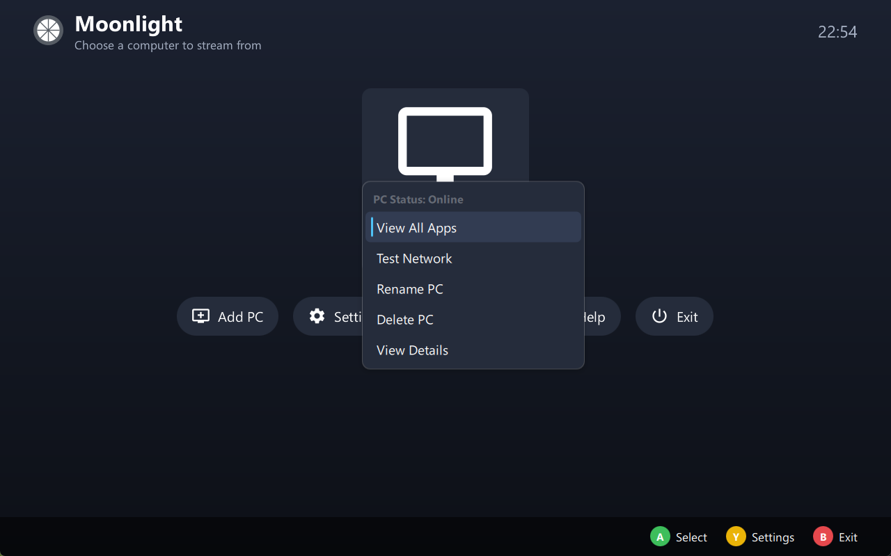
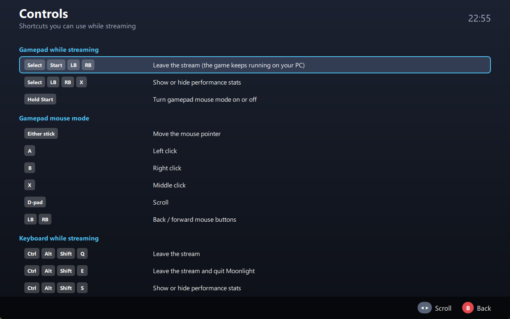
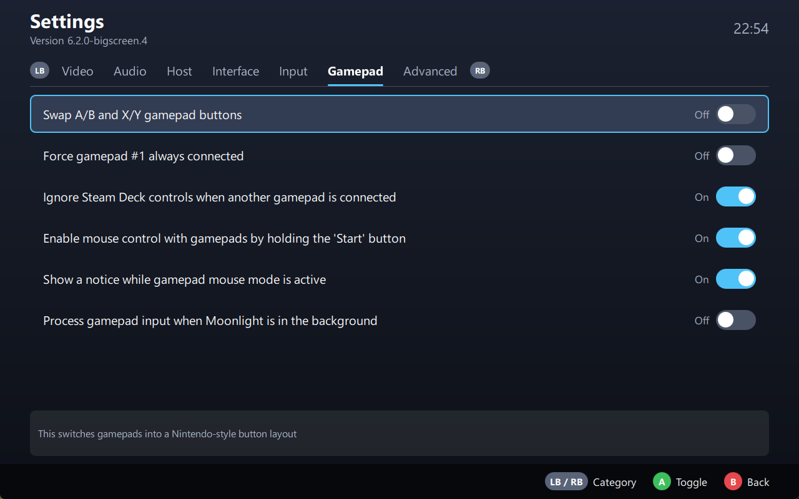

# Moonlight Big Screen

A fork of [Moonlight PC](https://github.com/moonlight-stream/moonlight-qt) with a **big-screen interface built for controllers**, for streaming games from your PC to a TV, a couch PC or a **Steam Deck**.

Moonlight streams games from a PC running [Sunshine](https://github.com/LizardByte/Sunshine) or NVIDIA GameStream. This fork keeps everything Moonlight does and adds a console-style interface: large tiles, everything reachable with a gamepad, and on-screen button hints. The regular desktop interface is still there, unchanged, whenever you want it.

## What's different from Moonlight

### A big-screen interface
- **Home screen** with large PC tiles that show each PC's status (online, offline, not paired), and buttons for Add PC, Settings, Controls, Help and Exit.
- **Game grid** with large box art, a "Running" badge, and the name of the selected game in the header.
- **Settings redesigned for controllers**: category tabs you switch with **LB / RB**, and every setting changed with **left / right**. A description of the selected setting is shown at the bottom.
- **Menus and dialogs** restyled to match, with large text and a clear focus highlight.
- **Controller hints** along the bottom of every screen (A / B / X / Y, with Nintendo-style labels if you swap the buttons).
- **Controls page** listing every gamepad, mouse-mode and keyboard shortcut you can use while streaming.
- Holding the D-pad scrolls continuously.

| Games | Settings |
|---|---|
|  |  |
| **Options menu** | **Controls** |
|  |  |

### Made for the Steam Deck
- **Starts in big-screen mode automatically** in Steam's Game Mode and Big Picture mode.
- **Ignores the Deck's built-in controls while another controller is connected**, so games like RetroArch don't pick the Deck as player 1. The built-in controls come back as soon as the other controller disconnects. *(Settings → Gamepad, on by default.)*
- Laid out and tested for the Deck's 1280×800 screen.

### Smaller changes
- **Option to hide the red "Gamepad mouse mode active" text** while using a controller as a mouse. *(Settings → Gamepad.)*
- **No "Are you sure you want to quit?" prompt** when you exit. Turn it back on with *Settings → Interface → Ask before quitting Moonlight*.
- New installs **start in big-screen mode**. Switch to the desktop interface with *Settings → Interface → GUI display mode → Windowed* and restart.
- The upstream update check is turned off, since it would point to official Moonlight releases that don't include these changes.

## When the big-screen interface is used

It's used when any of these is true:
- **GUI display mode** is set to **Fullscreen** (the default for new installs)
- Moonlight is launched from **Steam Game Mode or Big Picture**
- There's no desktop environment (for example a Raspberry Pi booted to a console)

You can force it either way with the `BIG_SCREEN_MODE=1` or `BIG_SCREEN_MODE=0` environment variable.

## Download

Get the latest version from the [Releases page](https://github.com/dwolp/moonlight-qt/releases).

### Steam Deck / Linux (AppImage)
1. Switch to **Desktop Mode** and download `Moonlight-…-x86_64.AppImage`.
2. Put it somewhere permanent, such as `~/Applications`.
3. Right-click it → **Properties** → **Permissions** → tick **Is executable**.
4. In Steam: **Games → Add a Non-Steam Game to My Library**, then browse to the AppImage.
5. Switch back to **Game Mode** and launch Moonlight from your library.

There's nothing to install. To update, replace the file with the new one and keep the same name so your Steam shortcut keeps working. Your settings and paired PCs are kept.

### Windows (portable)
Unzip `MoonlightPortable-x64-….zip` anywhere and run `Moonlight.exe`. Settings are stored in the same folder.

## Controller shortcuts while streaming

| Buttons | What it does |
|---|---|
| Select + Start + LB + RB | Leave the stream (the game keeps running on your PC) |
| Select + LB + RB + X | Show or hide performance stats |
| Hold Start | Turn gamepad mouse mode on or off |

All shortcuts, including the keyboard ones, are on the **Controls** page on the home screen.

## Building

This fork builds exactly like upstream Moonlight. See the [upstream build instructions](https://github.com/moonlight-stream/moonlight-qt#building). In short:

1. Install the Qt 6 SDK (on Windows, choose the **MSVC** kit; MinGW isn't supported).
2. Run `git submodule update --init --recursive`, and on Windows also `setup-deps.ps1`.
3. Open `moonlight-qt.pro` in Qt Creator, or run `qmake` followed by `make` / `nmake` / `jom`.

Pushing to `master` runs GitHub Actions, which builds the Linux AppImage plus Windows, macOS and Steam Link versions.

## Credits and license

All the streaming work is [Moonlight](https://moonlight-stream.org), by the Moonlight developers and contributors. This fork only changes the interface and a few controller behaviours. For help with streaming itself, see the [Moonlight setup guide](https://github.com/moonlight-stream/moonlight-docs/wiki/Setup-Guide).

Like Moonlight, this fork is licensed under the [GNU General Public License v3](LICENSE).
